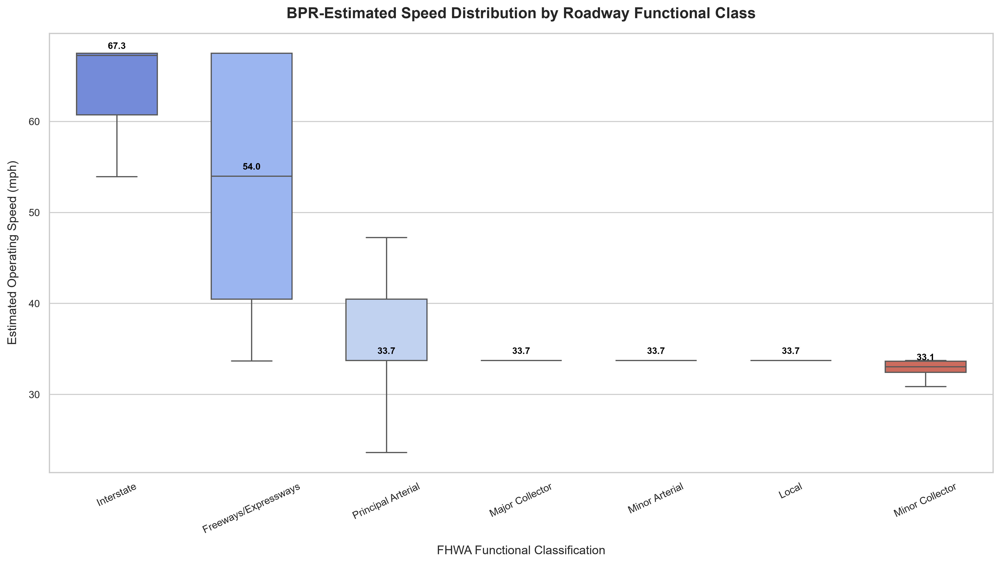
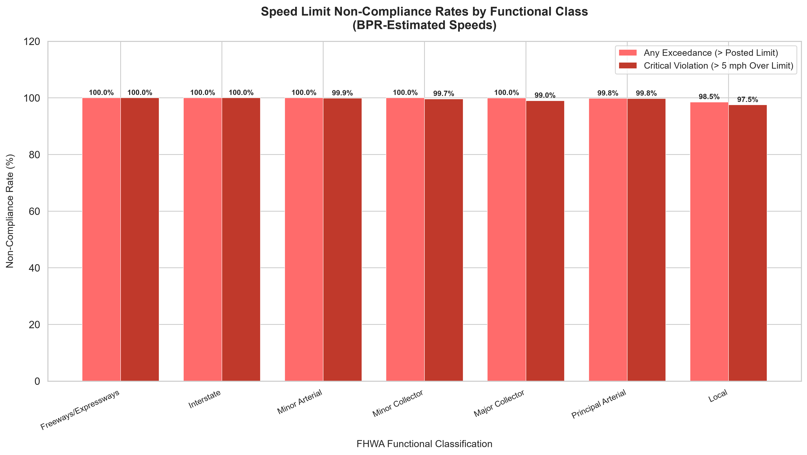

# Speed Limit Compliance Analysis Across Roadway Functional Classes

A high-performance geospatial data science and statistical analysis pipeline evaluating vehicle operating speeds and speed limit compliance rates across Federal Highway Administration (FHWA) roadway functional classes in New York City.

The pipeline integrates 1.84+ million Automated Traffic Recorder (ATR) volume observations with the Highway Performance Monitoring System (HPMS) statewide roadway geodatabase. Operating speeds are derived using the Bureau of Public Roads (BPR) speed-flow formulation calibrated to roadway physical capacity and posted limits, followed by hypothesis testing (One-Way ANOVA, Tukey HSD, Odds Ratios, and Chi-Square contingency analysis).

---

## 1. Problem Statement & Objectives

Urban roadway networks are designed hierarchically to balance mobility and land access. However, geometric design standards (lane widths, sight distances, clear zones) on higher-order facilities often induce operating speeds far exceeding posted speed limits, elevating conflict frequency and crash severity.

This project quantitatively assesses:
1. **Speed Differential Across Functional Classes**: Whether operating speeds and speed variance systematically vary across roadway classifications.
2. **Speed Limit Compliance**: Non-compliance rates and critical safety violations (> 5 mph over posted limit, reflecting NYC Vision Zero enforcement thresholds) across classifications.
3. **Statistical Risk Quantification**: Pairwise mean differences via Tukey HSD post-hoc tests and comparative risk odds (Odds Ratio and Relative Risk of Arterials vs. Local streets).

---

## 2. Methodology & Analytical Architecture

```
Raw Telemetry (1.87M ATR Records) + Quality Control Audit Table
                         │
                         ▼
        [1. Data Cleaning & Sensor Filtering]
         • Filter 15,098 records matching bad sensor coordinates (20 RequestIDs, 24 SegmentIDs)
         • Purge 15,257 non-numeric / null volume entries
         • Clean cohort: 1,844,799 records across 3,369 sensors
                         │
                         ▼
        [2. Geospatial Nearest-Neighbor Join]
         • HPMS 2024 New York network filtered to NYC 5 counties (Bronx, Kings, NY, Queens, Richmond)
         • Reproject ATR sensors (EPSG:2263) & HPMS links (EPSG:4326) to UTM Zone 18N (EPSG:32618)
         • Spatial nearest-neighbor join within 200m buffer (100% sensor match rate)
                         │
                         ▼
        [3. BPR Speed-Flow Derivation]
         • Hourly equivalent volume: V_hourly = Vol_15min × 4
         • Dynamic segment capacity: C = Lanes × Capacity_per_lane (1,000–2,200 pcphpl)
         • S_est = FFS / [1 + 0.15 × (V/C)^4], where FFS = 1.35 × Posted_Limit
                         │
                         ▼
        [4. Statistical Hypothesis Testing & Risk Quantification]
         • One-Way ANOVA across 7 functional classes
         • Tukey HSD pairwise post-hoc test (FWER α = 0.05)
         • Odds Ratio & Relative Risk (Arterials vs. Local) with 95% Confidence Intervals
         • Chi-Square test of independence on critical violation incidence
```

### Speed-Flow Model Formulation
Operating speeds are derived via the Bureau of Public Roads (BPR) formulation:

$$S_{\text{est}} = \frac{S_{\text{free}}}{1 + \alpha \left(\frac{V}{C}\right)^\beta}$$

Where:
- $S_{\text{free}}$ = Calibrated free-flow speed ($1.35 \times \text{posted limit}$ per NCHRP Report 855 / default classification values).
- $V$ = Hourly equivalent volume ($V_{15\text{-min}} \times 4$).
- $C$ = Segment capacity based on through-lanes and functional capacity ($1,000\text{--}2,200\text{ pcphpl}$).
- $\alpha = 0.15$, $\beta = 4.0$ (standard BPR parameters).

---

## 3. Key Empirical Findings

From execution on the 1,844,799 cleaned observation cohort:

| FHWA Functional Class | Record Count | Compliant (%) | Critical Violations (>5 mph over) | Mean Speed (mph) | Posted Limit (mph) | 85th Percentile Speed (mph) |
|---|---|---|---|---|---|---|
| **Freeways / Expressways** | 63,463 | 0.00% | 100.00% | 53.67 | 39.8 | 67.50 |
| **Interstate** | 36,696 | 0.00% | 100.00% | 64.05 | 47.5 | 67.50 |
| **Principal Arterial** | 753,772 | 0.20% | 99.76% | 37.01 | 27.5 | 40.50 |
| **Minor Arterial** | 461,005 | 0.00% | 99.86% | 34.64 | 25.7 | 33.75 |
| **Major Collector** | 145,361 | 0.01% | 99.03% | 34.60 | 25.6 | 40.50 |
| **Minor Collector** | 288 | 0.00% | 99.65% | 32.94 | 25.0 | 33.75 |
| **Local** | 384,214 | 1.46% | 97.53% | 33.31 | 24.9 | 33.75 |

### Statistical Test Results
- **One-Way ANOVA**:
  - $F = 10,683.47$, $p < 0.001$ ($p = 0.00\text{e}+00$, $k = 7$, $N = 1,844,799$).
  - Statistically establishes that mean operating speeds differ significantly across roadway functional classes.
- **Tukey HSD Post-Hoc Test ($\alpha = 0.05$)**:
  - **17 out of 21** pairwise functional class comparisons are statistically significant.
  - Principal Arterials operate significantly faster than Local streets (Mean Difference $= +3.70\text{ mph}$, $p < 0.001$).
  - Freeways and Interstates operate significantly faster than all surface street classifications ($p < 0.001$).
- **Risk Quantification (Arterials vs. Local)**:
  - **Odds Ratio**: $OR = 12.4310$ ($95\%\text{ CI}: [11.8907, 12.9958]$).
  - **Interpretation**: Arterials have **12.43× higher odds** of critical speed violations than Local roadways.
  - **Relative Risk**: $RR = 1.0232$.
- **Chi-Square Test of Independence**:
  - $\chi^2 = 21,737.29$, $df = 6$, $p < 0.001$.
  - Confirms speed violation likelihood is non-independent of roadway functional hierarchy.

---

## 4. Analytical Figures

### Operating Speed Distribution by Functional Class
Boxplot illustrating median operating speeds and interquartile dispersion across FHWA roadway classes:



### Speed Limit Non-Compliance Rates
Comparative bar chart showing overall exceedance vs. critical violations (> 5 mph above posted limit):



---

## 5. Repository Structure

```
speed-limit-compliance-analysis/
├── .gitignore                                            # Git exclusions for large datasets, pycache, and envs
├── README.md                                             # Technical overview, methodology, and reproduction guide
├── requirements.txt                                      # Pinned third-party Python dependencies
├── main_analysis.py                                      # Full modular data processing & modeling pipeline
├── data/
│   ├── README.md                                         # Schema and acquisition instructions for external datasets
│   ├── ATR_Location_Errors2025.xlsx                      # Flagged bad sensor location lookup table
│   └── Data_Dictionary_-_Automated_Traffic_Volume_Counts.xlsx # NYC DOT ATR data dictionary
└── outputs/
    ├── results_log.txt                                   # Full execution log and statistical test outputs
    └── figures/
        ├── barchart_noncompliance_by_class.png           # Non-compliance and critical violation rate plot
        └── boxplot_speed_variance_by_class.png           # Speed distribution boxplot by functional class
```

---

## 6. Setup & Installation

### Prerequisites
- Python 3.10+ (tested on Python 3.14)
- Git

### 1. Clone the Repository
```bash
git clone https://github.com/therishabhpro/speed-limit-compliance-analysis.git
cd speed-limit-compliance-analysis
```

### 2. Create and Activate a Virtual Environment
```bash
# macOS/Linux
python3 -m venv .venv
source .venv/bin/activate

# Windows (PowerShell)
python -m venv .venv
.venv\Scripts\Activate.ps1
```

### 3. Install Dependencies
```bash
pip install --upgrade pip
pip install -r requirements.txt
```

---

## 7. Data Placement & Execution

### 1. Acquire Large Datasets
Refer to [`data/README.md`](./data/README.md) for official download sources and place:
1. `Automated_Traffic_Volume_Counts_20260903.csv` inside `data/`
2. `HPMS2024.gdb/` inside `data/`

*(Note: If you have already placed the datasets in the repository root directory, `main_analysis.py` will automatically locate them via fallback resolution).*

### 2. Run the Analysis Pipeline
```bash
python main_analysis.py
```

The script executes the complete sequence:
1. Loads and cleans 1.87M raw ATR rows against `ATR_Location_Errors2025.xlsx`.
2. Reads the NYC boundary slice from `HPMS2024.gdb` using `pyogrio`.
3. Performs projected UTM metric nearest-neighbor spatial matching.
4. Computes operating speeds using the calibrated BPR model across Peak (7–10 AM, 4–7 PM) and Off-Peak intervals.
5. Performs One-Way ANOVA, Tukey HSD test, Odds Ratios, and Chi-Square contingency testing.
6. Regenerates and saves high-resolution figures to `outputs/figures/`.

---

## 8. Reproducibility & Technical Limitations

1. **Volume-Derived Speed Approximations**: Operating speeds are derived from high-resolution volume counts using the standard Bureau of Public Roads (BPR) congestion decay function. While standard in transportation planning when continuous spot speed radar is unavailable, derived speeds reflect macroscopic link conditions rather than instantaneous individual vehicle telemetry.
2. **Computational Hardware**: Executing spatial joins on 53,790 polylines and 3,369 point coordinates requires `pyogrio` and `geopandas` with GEOS support. Processing the full 1.84M records completes in under 2 minutes on a modern multi-core workstation.
3. **Data Freshness**: Telemetry reflects NYC DOT ATR deployments spanning 2000–2026; HPMS geometries reflect the 2024 NYSDOT statewide submittal.

---

## 9. License

This project is licensed under the MIT License - see the repository root for details.
